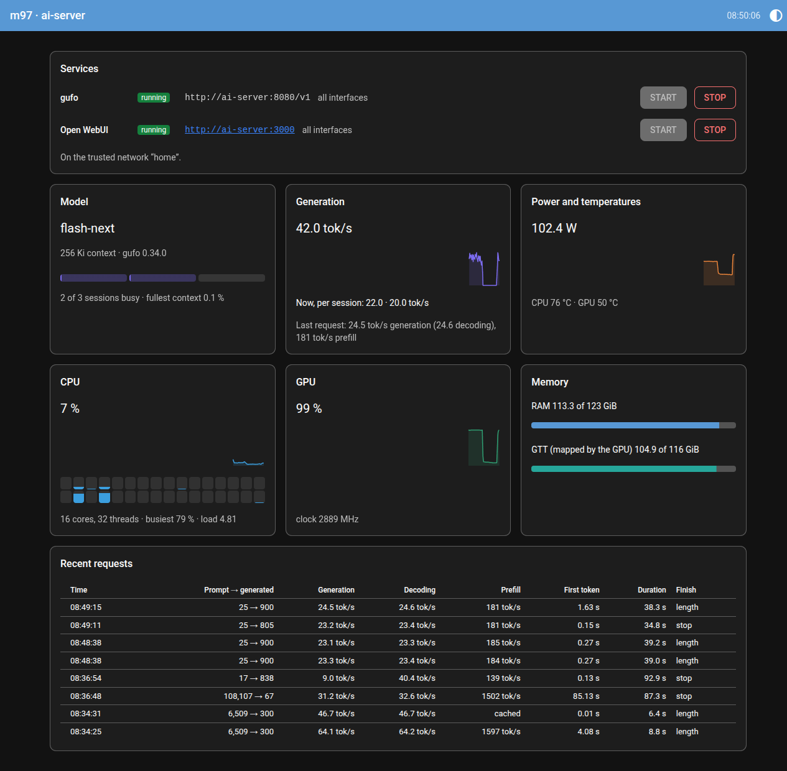

# m97


[](https://codecov.io/gh/Technologicat/m97)


A web dashboard and control panel for a [gufo](https://github.com/gufo-org/gufo) LLM server on AMD Strix
Halo: what the machine and the model are doing — power, temperatures, memory, GPU and CPU load, generation
speed, recent requests, how the machine's time is spent day by day — and buttons to start and stop gufo and [Open WebUI](https://github.com/open-webui/open-webui),
for the people in the household who never open a shell. Optionally, it runs
[Raven](https://github.com/Technologicat/raven)'s server and its MCP server too, which give Open WebUI's
model web search and page fetch.



For my stance on AI contributions, see the [collaboration guidelines](https://github.com/Technologicat/substrate-independent/blob/main/collaboration.md).

## Contents

- [Requirements](#requirements)
- [Install and uninstall](#install-and-uninstall)
- [Running it](#running-it)
- [Opening the dashboard](#opening-the-dashboard)
- [What the page shows](#what-the-page-shows)
- [How the time is spent](#how-the-time-is-spent)
- [The data as JSON](#the-data-as-json)
- [Configuration](#configuration)
- [Who can press the buttons](#who-can-press-the-buttons)
- [What it reads](#what-it-reads)
- [Development](#development)
- [License](#license)

## Requirements

- Linux, on an AMD APU with the `amdgpu` driver. The sensors are read from sysfs; m97 was built on a Strix
  Halo machine (Radeon 8060S, `gfx1151`).
- Rootless [podman](https://podman.io/), with gufo's host preparation done as in gufo's
  [install guide](https://github.com/gufo-org/gufo/blob/main/docs/install.md): GPU device access, the GTT
  size, unlimited locked memory. m97 runs gufo from its `gufo-runtime` container image.
- The model files, in a directory on the host (`~/models` by default).
- Python 3.11 or newer, and [pipx](https://pipx.pypa.io/) to install m97 in a virtualenv of its own.
- NetworkManager, to recognize trusted networks. Without it, m97 still runs, and treats every network as
  untrusted.

## Install and uninstall

```bash
pipx install m97
```

That puts the `m97` command on your `PATH`. For the development version instead, `pipx install
git+https://github.com/Technologicat/m97`. To update, `pipx upgrade m97`, then `m97 install` again if you
run it as a service (see below), so the service picks up the new version.

To uninstall, remove the service first if you installed one, then the software:

```bash
m97 uninstall
pipx uninstall m97
```

Your settings file, `~/.config/m97/settings.toml`, is left in place; delete it by hand if you no longer
want it.

## Running it

**As a service**, which is the usual way on a headless server. m97 then starts at boot and restarts if it
crashes:

```bash
m97 install          # install and enable the systemd user service, and start it
m97 status           # running or not, and the URL to open
m97 stop             # stop it
m97 start            # start it again
m97 logs [-f]        # its log (-f keeps following it)
m97 uninstall        # stop, disable and remove the service
```

The service serves the whole network. `m97 install --local` serves this machine only instead.

A systemd user service runs only while you are logged in, unless lingering is enabled for your user. For a
server that should start m97 at boot, before anyone logs in, enable it once:

```bash
loginctl enable-linger "$USER"
```

**Autostart.** m97 remembers which services were running, and when it starts, say at boot, it starts
them again. It waits for the network first, since a service started before the machine has joined a
trusted network would listen on this machine only. gufo comes first, and Open WebUI once gufo is up;
likewise Raven-server, and raven-mcp once Raven-server is up.

- A service counts as wanted running once m97 sees it running, however it was started: from the page, or
  from a shell. It counts as wanted stopped once it has been down for half a minute while m97 runs.
- A service that stops by itself is reported on the page, with its exit code, its last log lines and what
  to do. m97 does not restart it, and does not start it at boot until it has run again. The report stays
  across a restart of m97.
- The state is kept in `~/.local/state/m97/state.json`, beside the [usage tally](#how-the-time-is-spent). To turn autostart off, set `autostart = false` under
  `[server]`.

**The services from a shell.** On the server, the running m97 starts, stops and restarts them as the
buttons do, so autostart remembers the outcome:

```bash
m97 gufo restart             # stop gufo and start it again; it counts as wanted running throughout
m97 gufo start | stop
m97 openwebui start | stop | restart
m97 raven-server start | stop | restart    # once set up; see Raven, under Configuration
m97 raven-mcp start | stop | restart
```

Each waits until the action is done, and exits with status 1 if it failed. One still waiting when m97 itself
restarts loses its answer and exits with status 1 too; `m97 report` shows where the service got to, and the
command can be run again. m97 reads `settings.toml` only
when it starts, so after editing it, restart m97 first (`m97 stop`, `m97 start`; the services keep
running), and then the service.

**In the foreground**, for trying it out or for debugging. Ctrl+C stops it:

```bash
m97 serve            # this machine only
m97 serve --lan      # the whole network
```

## Opening the dashboard

Point a web browser at port **8097** of the machine m97 runs on:

```text
http://<server-name>:8097
```

- `<server-name>` is the machine's hostname, if your router resolves hostnames; otherwise its mDNS name,
  `<hostname>.local`, or its IP address.
- On the server itself, `http://127.0.0.1:8097` always works.
- `m97 status` prints the address, and says whether m97 listens on all interfaces or on this machine only;
  `m97 serve` prints it at startup.

The port is a setting (`port` under `[server]`, below). The page needs no login: viewing is open to anyone
who can reach it, and only the buttons are guarded (see [who can press the buttons](#who-can-press-the-buttons)).

## What the page shows

The page updates itself, once a second; the graphs reach back ten minutes (both settings, under
[`[history]`](#configuration)). The button at the top right
switches between dark and light. From the top:

- **Services**: gufo and Open WebUI, and Raven-server and raven-mcp if [set up](#raven-optional), each with
  its status (running, starting, stopping, stopped), its address, and whether it listens on all interfaces
  or on this machine only.
  - **Start** and **Stop**. Stop also cancels a start still in progress.
  - A Raven service run by hand, outside m97, shows as running, with the note "started outside m97". m97
    does not stop it: Stop says to stop it where it was started.
  - When a service fails to start, or stops by itself, the reason is shown under it, with its last log
    lines one click away.
  - Off the trusted networks, a PIN field, if a PIN is set.
- **Model**: the model gufo serves, its context per session, and gufo's version.
  - A bar per session, filled as far as its context is. While a prompt is prefilled, the part still to
    compute is amber, and the computed part creeps across it. Hovering over a bar gives that session's speed
    and token counts.
  - How many sessions are busy, how many requests are waiting for one, and how full the fullest context is.
- **Generation**: tokens per second across all sessions, with its graph; while requests run, the speed of
  each; while a prompt is prefilled, the prefill's speed, how far it has got, and the time left; and the last
  finished request's speeds.
  - The prefill speed is averaged over the prefill so far, since gufo reports its progress a chunk of 4,096
    tokens at a time. It shows from the first chunk on.
- **Power and temperatures**: the socket power, CPU and GPU together, with its graph, and the CPU and GPU
  temperatures.
- **CPU**: the load, with its graph, and a bar per thread, grouped by physical core: a column per core, its
  threads one above the other, 16 columns to a row; the busiest thread, and the load average.
- **GPU**: the load, with its graph, and the clock.
- **Memory**: RAM, and GTT, the part of the system memory the GPU has mapped, which is where gufo keeps the
  model.
- **Recent requests**: the finished chat requests, newest first: tokens in and out, the speeds, the time to
  the first token, the duration, and why it finished.
- **Usage**: the last 14 days, as in [how the time is spent](#how-the-time-is-spent).

**Open WebUI has accounts of its own.** The first account created on it becomes its administrator, and
sign-up then closes: so create yours before telling anyone else the address. To let the others in:

- **Create their accounts** in the admin panel's list of users, from their email addresses.
- **Or open sign-up again** (Open WebUI's admin settings, under General). An account created that way waits on
  a "pending" screen until the administrator gives it a role, in the same list of users.

## How the time is spent

The **Usage** card, at the bottom of the page, shows how each of the last 14 days divided, as a stacked bar
of hours. m97 counts it itself as it samples, once a second, by what gufo was doing:

- **Serving**: gufo ready, and at least one session generating or reading a prompt.
- **Loaded, idle**: gufo ready, with the model loaded and no session busy.
- **Loading**: gufo's container running, the model not loaded yet.
- **Stopped**: gufo's container not running.
- **m97 off**: the rest of the day, which m97 did not see: the machine off or asleep, or m97 itself not
  running. m97 cannot tell these apart, so it does not try. For today, the bar runs up to the present.

Beside the bars, today's and the 14 days' totals, in hours and in energy (Wh, from the socket power: CPU and
GPU together), for three things:

- **gufo serving**, and **gufo loaded, idle**: the two categories above.
- **Other GPU use**: the time the GPU was busier than 30 % while gufo was not serving, whatever was using it.
  It overlaps the categories rather than being one of them.

Hovering over a day gives each category's hours and energy, the day's total energy, and its other GPU use.

Days run from local midnight to midnight. The tally is kept in `~/.local/state/m97/usage.json`, saved once a
minute and when m97 stops, so a restart of m97 continues the day.

## The data as JSON

Everything the page shows is also served as JSON, at `/api/status` on the same port, for scripts and for AI
agents working on other machines. Like the page, it is read-only and needs no PIN.

```bash
curl -s http://<server-name>:8097/api/status            # the current state
curl -s "http://<server-name>:8097/api/status?history=1"  # plus the graphs' series
```

The per-day usage is at `/api/usage`, below. On a machine with m97 installed, `m97 report` prints the
current state as text, with a line of usage for today and for the last 7 days:

```bash
m97 report                                   # this machine's m97
m97 report --url http://<server-name>:8097   # another machine's
m97 report --json [--history]                # the JSON, unformatted
```

`m97 report` exits with status 1 when m97 does not answer; a stopped service is a normal report. The keys:

- **`schema`**: the payload's version. It goes up when a key changes meaning or goes away, not when one is
  added.
- **`m97_version`**, **`time`** (ISO 8601, UTC), **`hostname`**, **`network`** (`trusted`, and the trusted
  network's `name`).
- **`services`**: for `gufo` and `openwebui`, and `raven-server` and `raven-mcp` if set up, the `title`, the
  `status` the page shows (`running`, `starting`, `stopping`, `stopped`, or `unknown` for the moment after m97
  starts, before it has asked), the `container` state for a container or the `unit` state for a systemd unit
  (`running`, `failed`, `outside` for one started outside m97, or `null`), the `note` the page shows beside the
  status, the `url`, the `scope` it listens on (`all`, `local`, or `null` when not listening), and any `error`.
- **`model`** (`name`, `gufo_version`, `context_tokens`), **`generation`** (total `tps`, requests `deferred`,
  and the `prefill` under way: `sessions`, tokens `done` of `total`, `tps`, `eta_s`; `null` when none is)
  and **`sessions`** (per session: `busy`, live `tps`, `prompt_tokens`, `generated_tokens`, `context_tokens`,
  the context `fill` from 0 to 1, and `prefilling`, `prefill_done`, `prefill_total`, `prefill_tps`,
  `prefill_eta_s`). `null` or empty while gufo is not ready.
- **`host`**: the sensors, with units in the key names (`ppt_w`, `cpu_temp_c`, `gpu_busy_pct`, `ram_used_gib`
  …), per-thread CPU load in `cpu_thread_pct`, and `cpu_cores`, the threads grouped by physical core.
- **`requests`**: the recent finished requests, newest first, with `output_tps` (the speed delivered,
  wall-clock from the first token) beside gufo's own `decode_tps`.
- **`usage`**: `today` and `last_7_days`, in hours per category (`serving_h`, `idle_h`, `loading_h`,
  `stopped_h`, `m97_off_h`, `gpu_other_h`) and energy in Wh (`serving_wh` …, `gpu_other_wh`), as at
  [`/api/usage`](#usage-per-day).
- **`history`**, only when asked for: `interval_s`, `seconds_ago`, and the series `ppt_w`, `gpu_busy_pct`,
  `cpu_busy_pct` and `gen_tps`, oldest first.

A value m97 does not have is `null`. **Numbers carry the decimals the page shows them with**, so a figure quoted
from here is the one a person sees on the page.

An example, from a server with two chats running, trimmed to three of the CPU threads, two of the cores and one
request:

```json
{
  "schema": 1,
  "m97_version": "0.3.0",
  "time": "2026-11-20T13:05:13Z",
  "hostname": "ai-server",
  "network": {"trusted": true, "name": "home"},
  "services": {
    "gufo": {"title": "gufo", "status": "running", "container": "running", "unit": null, "note": null,
             "url": "http://ai-server:8080/v1", "scope": "all", "error": null},
    "openwebui": {"title": "Open WebUI", "status": "running", "container": "running", "unit": null,
                  "note": null, "url": "http://ai-server:3000", "scope": "all", "error": null}
  },
  "model": {"name": "flash-next", "gufo_version": "0.34.0", "context_tokens": 262144},
  "generation": {"tps": 60.0, "deferred": 0},
  "sessions": [
    {"id": 0, "busy": true, "tps": 38.0, "prompt_tokens": 2115, "generated_tokens": 1819,
     "context_tokens": 262144, "fill": 0.015},
    {"id": 1, "busy": true, "tps": 22.0, "prompt_tokens": 3137, "generated_tokens": 2538,
     "context_tokens": 262144, "fill": 0.022},
    {"id": 2, "busy": false, "tps": null, "prompt_tokens": 0, "generated_tokens": 0,
     "context_tokens": 262144, "fill": 0.0}
  ],
  "host": {
    "ppt_w": 60.3, "cpu_temp_c": 56, "gpu_temp_c": 55, "gpu_busy_pct": 99, "gpu_mhz": 2375,
    "cpu_busy_pct": 7, "cpu_thread_pct": {"0": 4, "1": 2, "2": 7}, "load1": 1.84,
    "ram_used_gib": 114.4, "ram_total_gib": 123, "gtt_used_gib": 105.9, "gtt_total_gib": 116,
    "cpu_cores": [[0, 16], [1, 17]]
  },
  "requests": [
    {"time": "2026-11-20T13:04:09Z", "prompt_tokens": 17323, "generated_tokens": 2157,
     "output_tps": 30.4, "decode_tps": 31.6, "prefill_tps": 1336, "prompt_cached": false,
     "first_token_s": 15.03, "duration_s": 85.9, "finish": "stop"}
  ],
  "usage": {
    "today": {"serving_h": 3.5, "idle_h": 4.5, "loading_h": 0.0, "stopped_h": 0.0, "m97_off_h": 8.7,
              "gpu_other_h": 0.0, "serving_wh": 224, "idle_wh": 30, "loading_wh": 0, "stopped_wh": 0,
              "gpu_other_wh": 2},
    "last_7_days": {"serving_h": 15.0, "idle_h": 39.2, "loading_h": 0.1, "stopped_h": 0.0, "m97_off_h": 106.5,
                    "gpu_other_h": 0.1, "serving_wh": 935, "idle_wh": 250, "loading_wh": 1, "stopped_wh": 0,
                    "gpu_other_wh": 5}
  }
}
```

### Usage per day

`/api/usage` serves the [usage tally](#how-the-time-is-spent) a day at a time, the last 14 days by default:

```bash
curl -s "http://<server-name>:8097/api/usage?days=30"
```

The payload is `{"schema": 1, "days": [...]}`, oldest day first and today last. Each day carries its
`date` (local, ISO 8601) and the keys of `usage` above; a day m97 never saw is all `m97_off_h`. Hours have
one decimal and Wh none, as on the page.

```json
{"date": "2026-11-20", "serving_h": 3.2, "idle_h": 5.1, "loading_h": 0.0, "stopped_h": 0.4,
 "m97_off_h": 6.3, "gpu_other_h": 0.0, "serving_wh": 251, "idle_wh": 97, "loading_wh": 0,
 "stopped_wh": 2, "gpu_other_wh": 0}
```

## Configuration

m97 reads its settings from **`~/.config/m97/settings.toml`**. The file is optional: without it, m97 runs
on its defaults, which are in [`m97/settings.toml`](https://github.com/Technologicat/m97/blob/main/m97/settings.toml), each with a comment saying what it
does.

Your file overrides the defaults key by key, so it only needs the keys you want to change. A table in your
file merges into the default table of the same name; any other value, a list included, replaces the default
whole. A key m97 does not know is reported in its log as a probable typo and ignored. A value of the wrong
type stops m97 at startup with a message naming the key.

A typical file:

```toml
[access]
pin = "2468"                       # a string, so that leading zeros survive

[[access.trusted_networks]]
name = "home"
connections = ["…UUID of the home Wi-Fi profile…"]
subnet = "192.168.1.0/24"          # optional

[[access.trusted_networks]]
name = "cabin"
connections = ["…2.4 GHz profile…", "…5 GHz profile…"]

[gufo]
image = "ghcr.io/gufo-org/toolboxes/gufo-runtime:0.34.0"   # pin a gufo version
sessions = 3
context = 262144
```

The settings, by table:

- **`[server]`**: `port` (8097), and `autostart` (on; see [running it](#running-it)).
- **`[access]`**: the `pin`, and the `trusted_networks`; see [who can press the buttons](#who-can-press-the-buttons).
- **`[gufo]`**: how m97 runs gufo. `image`; `models_dir` (mounted read-only at `/models` in the container);
  `model` and `mtp_model`, as paths relative to `models_dir` (an empty `mtp_model` turns speculative
  decoding off); `served_name`, the model ID clients ask for; `sessions` and `context` (0 means gufo's own
  default); `port`; `extra_args`, a list appended to the `gufo serve ... llm` command line; `container`, the
  container's name; `start_timeout` in seconds. The defaults serve Qwen3.8 Flash-Next as in gufo's
  quickstart.
- **`[openwebui]`**: `image`, `volume` (the podman volume that holds accounts and chats), `port`,
  `container`, `start_timeout`, and `mounts`: host folders mounted read-only into the container, for Open
  WebUI's plugins to read, as `"host:container"` strings. A host path that does not exist is skipped, with
  a warning in the log, so that a stale entry cannot keep Open WebUI from starting. Open WebUI is pointed
  at gufo's port.
- **`[raven-server]`** and **`[raven-mcp]`**: `command`, empty by default, which leaves the service off; `unit`,
  the systemd unit's name; `port`; `extra_args`; `start_timeout`. See [Raven](#raven-optional), below.
- **`[history]`**: `seconds` the graphs reach back (600), and the sampling `interval` (1.0).

m97 recognizes a service by its container name, so a container started some other way, by hand or by a
script, shows up on the page as long as the name matches.

### Raven, optional

[Raven](https://github.com/Technologicat/raven) is a set of local AI apps. Two of its programs can run under m97:

- **Raven-server**, which serves specialized AI models, and does Raven's web search and page fetch.
- **raven-mcp**, Raven's MCP server, which offers those tools, and Raven's lorebook, to LLM frontends over
  the [Model Context Protocol](https://modelcontextprotocol.io/). Without Raven-server it still starts, and
  its web tools answer that the web is unavailable.

Both are off unless set up. To set them up, install Raven, and give each its program in Raven's venv:

```toml
[raven-server]
command = "~/Documents/koodit/raven/.venv/bin/raven-server"

[raven-mcp]
command = "~/Documents/koodit/raven/.venv/bin/raven-mcp"
```

Then restart m97, and each gets a row on the page and its `m97 raven-server` or `m97 raven-mcp` command.

- **They are host processes, not containers.** m97 runs each as a transient systemd user unit,
  `m97-raven-server` and `m97-raven-mcp`, so they keep running across a restart of m97, like the
  containers. A unit's log is in the journal: `journalctl --user -u m97-raven-mcp`.
- **raven-mcp is pointed at the Raven-server m97 runs**, on its port. With only raven-mcp set up, it uses
  the Raven-server in Raven's own settings.
- **On a trusted network both serve the LAN**, like the containers; elsewhere this machine only. raven-mcp
  serves at `http://<server-name>:8130/mcp`, the address to give an MCP client.
- **A program run by hand** on the service's port shows as running, "started outside m97", and m97 leaves it
  alone. Stop it where it was started before starting it from m97.

**To give Open WebUI's model the tools**, add raven-mcp in Open WebUI's Admin Panel, under Settings ›
Integrations, as an MCP server (Streamable HTTP) at `http://127.0.0.1:8130/mcp`. Open WebUI runs on the host's network, so the loopback
address reaches raven-mcp wherever it listens.

A fuller file, with a key or more from every table. Its mounts are for
[grimoire](https://github.com/Technologicat/grimoire), which gives Open WebUI's model the definitions of your
own terms from a folder of Markdown files:

```toml
[server]
port = 8097
autostart = true

[access]
pin = "2468"

[[access.trusted_networks]]
name = "home"
connections = ["…UUID of the home Wi-Fi profile…"]
subnet = "192.168.1.0/24"

[gufo]
image = "ghcr.io/gufo-org/toolboxes/gufo-runtime:0.34.0"
models_dir = "/data/models"        # the models on a second drive
sessions = 3                       # three chats at once
context = 262144                   # tokens per session
extra_args = ["--cache-ram-bytes", "off"]

[openwebui]
image = "ghcr.io/open-webui/open-webui:v0.13.3"   # pin an Open WebUI version
# Folders for Open WebUI's plugins, here a lorebook for grimoire's filter and tool, whose valves are set to
# the paths inside the container. The lorebook holds a symlink to a glossary kept in another folder, so that
# folder is mounted too, at the same path as on the host: inside the container, a symlink to a host path
# resolves only if its target is mounted where it points.
mounts = ["~/.config/raven/librarian/lorebook:/lorebook",
          "~/Documents/glossaries:/home/me/Documents/glossaries",
          "~/.config/raven/librarian/lorebook_expansion:/lorebook_expansion"]

[history]
seconds = 1800                     # graphs reaching back half an hour
```

## Who can press the buttons

Viewing is always open. The start and stop buttons are open **while the server is on a trusted network**,
and need the **PIN** on any other network. With no PIN set, off the trusted networks they stay locked, and
the page says what to configure.

The [`m97 gufo`, `m97 openwebui` and Raven commands](#running-it) work on any network, for the user m97 runs as,
on the server itself. m97 accepts them from the loopback address only, with a token it writes at each start
to `~/.local/state/m97/control-token`, a file only that user can read.

A trusted network is recognized by the UUID of the NetworkManager connection the server is using. List the
saved connections and their UUIDs with:

```bash
nmcli -t -f NAME,UUID connection show
```

A network with several saved profiles, say one per Wi-Fi band, lists all of them under `connections`. The
optional `subnet` adds a second condition: the server's address must also be inside it. A network that
has never been joined has no saved profile, and so no UUID yet; join it once, then add it.

NetworkManager offers a saved Wi-Fi profile only to an access point with the same name *and* compatible
security, so an open network that borrows a trusted network's name does not count as trusted. Anyone who
knows the Wi-Fi password could still set up a look-alike.

Two more things follow from the network:

- **Services started from the page listen on all interfaces only on a trusted network.** Elsewhere they
  listen on this machine only, whoever pressed the button.
- **The PIN travels unencrypted**, since m97 serves plain HTTP. On an untrusted network, someone watching the
  traffic could read it. Wrong guesses are limited to five per five minutes for each client address.

## What it reads

Everything without root:

- **Host sensors** from sysfs and procfs: socket power, CPU (Tctl) and GPU edge temperatures, GPU load and
  clock, CPU load, RAM, and GTT, the system memory the GPU has mapped. The sensors are found by driver
  name, since hwmon indices change between boots.
- **gufo's HTTP endpoints**, only while its container runs: `/ready`, `/props`, `/slots` (which sessions are
  busy, and their live speed), `/metrics` (the total generation throughput).
- **gufo's log**, for the recent requests: each finished chat request's token counts, speeds and timings.
- **Its own samples, added up per day**, for the usage tally. Besides that, all m97 keeps on disk is which
  services should run, and the report of any that stopped by itself.
- **Container state** from `podman events`, and **the network** from `nmcli monitor`, so m97 starts no
  processes periodically. A Raven service's unit state comes from `systemctl --user show`, asked only when
  its port opens or closes. It takes about 0.5 % of one CPU core, plus about 0.1 % per open page (measured
  on the server above).

## Development

```bash
git clone https://github.com/Technologicat/m97
cd m97
pdm install          # creates .venv, installs m97 editable with the dev tools
pdm run pytest tests/
```

The design, and the decisions behind it, are in [`briefs/done/dashboard.md`](https://github.com/Technologicat/m97/blob/main/briefs/done/dashboard.md).

## License

BSD 2-Clause, see [`LICENSE.md`](https://github.com/Technologicat/m97/blob/main/LICENSE.md).
